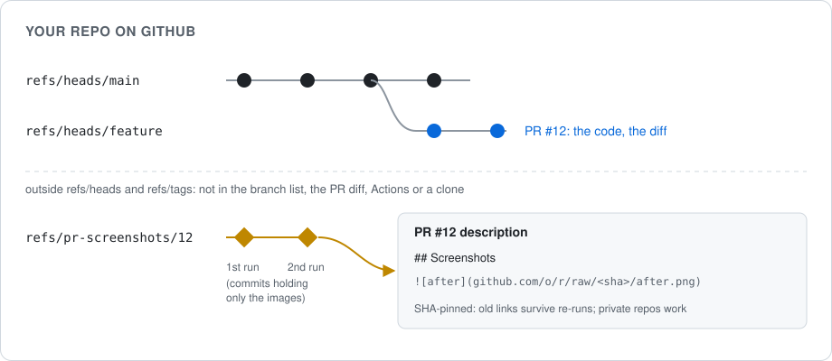
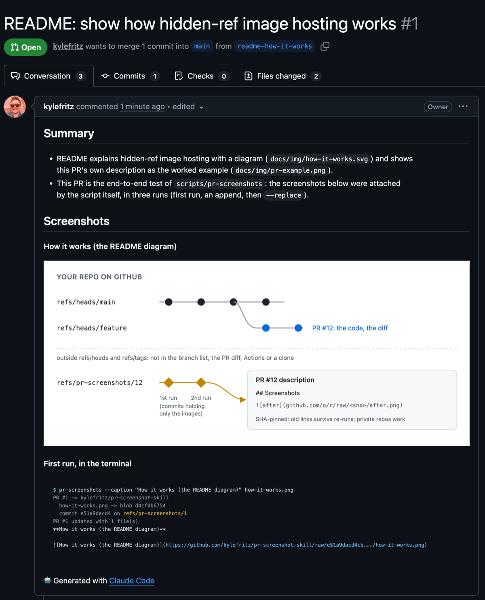

# pr-screenshot-skill

A [Claude Code](https://claude.com/claude-code) skill that puts screenshots in GitHub PR
descriptions, hosted in the repo itself: no S3 bucket, no third-party upload, no image files on
your branch, and it works for private repos. Images beat words, so the skill also tells the agent
when to reach for one: every visible change, and any change a picture explains faster (a
before/after, a terminal render, a timing chart).



## The trick: hidden-ref image hosting

`scripts/pr-screenshots` writes each image into the repo's object store with git plumbing
(`hash-object`, `mktree`, `commit-tree`) and pushes that commit to `refs/pr-screenshots/<pr>`, then
links it from the PR description as `https://github.com/<owner>/<repo>/raw/<sha>/<file>`.

- **Invisible everywhere it would be noise.** A ref outside `refs/heads` and `refs/tags` isn't in
  the branch list, the PR's diff, a normal clone, or Actions (push events only fire for branches
  and tags).
- **Private repos work.** `github.com/.../raw/<sha>/...` redirects a logged-in viewer with access to
  a tokened URL. (`raw.githubusercontent.com` links 404 in a private repo; that bug shipped broken
  screenshots once, which is why the script never writes them.)
- **Re-runs never break old links.** URLs are pinned to a commit SHA, and each run's commit has the
  previous one as its parent and carries its files forward.
- **Works in locked-down sandboxes.** It uses git transport only, no REST upload API, and falls
  back to a `screenshots/pr-<pr>` branch where a remote refuses refs outside `refs/heads`.
- **Edits only its own part of the description**, between `<!-- pr-screenshots:begin/end -->`
  markers, appending by default or replacing with `--replace`.

Here is this repo's first PR, with its screenshots attached by the script:



## Install

```bash
git clone https://github.com/kylefritz/pr-screenshot-skill ~/code/pr-screenshot-skill
ln -s ~/code/pr-screenshot-skill ~/.claude/skills/pr-screenshots
ln -s ~/code/pr-screenshot-skill/scripts/pr-screenshots ~/.local/bin/pr-screenshots   # optional: on PATH
```

Needs `git`, Python 3 and the [GitHub CLI](https://cli.github.com) logged in with push access.
Then Claude puts screenshots on PRs by itself; you can also ask: "add before/after screenshots to
PR 42", "show the new timing in the PR as a chart".

## Usage

Run it from inside a clone of the repo, after the PR exists:

```text
pr-screenshots [--pr N] [--repo owner/name] [--remote origin]
               [--replace] [--print] [--dry-run]
               [--caption TEXT] FILE [[--caption TEXT] FILE ...]
```

| Example | What it does |
|---|---|
| `pr-screenshots before.png after-phone.png` | upload to the current branch's PR and append to `## Screenshots` |
| `pr-screenshots --caption "Cart, phone, empty" cart.png` | caption the next file (default caption: the file name) |
| `pr-screenshots --replace shots/*.png` | replace the section instead of appending |
| `pr-screenshots --pr 12 --print chart.png` | upload and print markdown only, for a comment or an issue |
| `pr-screenshots --dry-run shots/*.png` | show what it would do |

Markdown goes to stdout, progress to stderr. png, jpg, gif, webp and svg embed; mp4, mov, webm
and pdf become links.

## Trade-offs

- The images are repo weight for as long as the ref exists. Screenshots are small; keep video
  short. Files over 50 MB are refused.
- Deleting a ref (`git push origin --delete refs/pr-screenshots/12`) breaks that PR's images once
  GitHub garbage-collects the commit.
- In a public repo the images are public. The skill tells the agent to check every frame for
  secrets and personal data, and to use demo data.

## What's in here

| File | What it does |
|---|---|
| `SKILL.md` | the instructions Claude follows: when to take screenshots, how, and how to check them |
| `scripts/pr-screenshots` | the uploader (Python 3, standard library only) |

## License

MIT. See [LICENSE](LICENSE).
